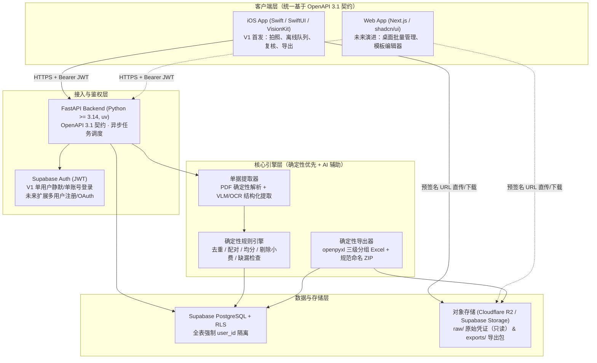
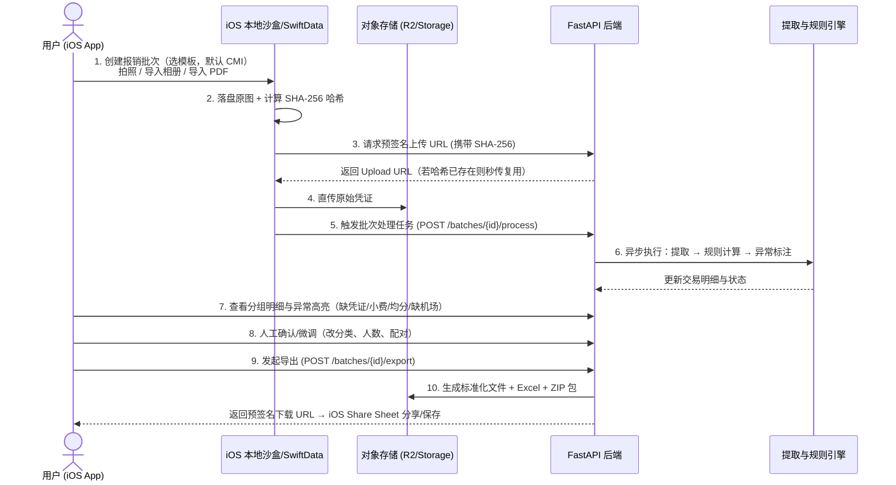

# 智能报销助手 — 高层设计文档（HLD）

## 1. 背景与建设目标

当前报销流程依赖手动将手机拍摄的单据导入电脑，再通过本地脚本或人工整理，存在**采集链路长、跨设备同步繁琐、规则固化在本地文档**等问题。本项目旨在构建一款**移动端优先（iOS V1）、云端规则驱动、面向未来 Web 与多用户演进**的智能报销助手：

1. **手机端直接采集与本地留存**：支持 iOS 原生拍照（含文档边缘矫正）、相册/文件导入与离线缓存，无需导出至电脑。
2. **可配置规则模板引擎**：将现有 `CMI 报销规则` 抽象为结构化 DSL 并作为系统**默认模板（Default Template）**，支持用户自定义或派生新模板。
3. **自动化处理与标准导出**：自动完成 OCR/多模态单据识别、去重、Invoice 与付款凭证配对、小费剔除、多人均分、三级分组汇总，并一键导出标准化重命名凭证与 Excel 汇总表（ZIP 包）。
4. **iOS App Store 首发**：V1 基于 Swift + SwiftUI 原生开发，满足 App Store 上架与隐私合规要求。
5. **Web 端契约预留**：采用 Contract-First（OpenAPI 3.1）前后端分离架构，核心业务逻辑与状态机完全下沉至服务端，未来 Web 端可直接复用。
6. **多用户数据隔离预留**：V1 仅面向单用户使用，但数据库 Schema、鉴权上下文（JWT）与行级安全策略（RLS）从第一天起按多租户设计，未来开放多用户零破坏性迁移。

---

## 2. 系统总体架构

### 2.1 架构分层图

### 2.2 核心设计原则

1. **确定性程序优先于 LLM**：
   - OCR/VLM 仅负责“从非结构化图片/PDF 中提取客观要素”（商户、日期、金额、币种、小费、人数、单号、是否含 Paid 字样等）。
   - **去重、Invoice+Receipt 配对、小费剔除、多人均分、分类与地域映射、机场往返成对检查、文件重命名、Excel 公式汇总**全部由服务端**确定性 Python 代码**执行，确保结果 100% 可预测、可单测、可追溯。
2. **原始凭证不可变（Immutable Raw）**：
   - 客户端与服务端均严格保护原始文件（对应原 `raw/` 目录），严禁覆盖或修改原图，所有导出文件均为衍生副本。
3. **离线优先（Offline-First）**：
   - iOS 端拍照后立即写入本地沙盒与本地数据库（SwiftData），无网络时亦可创建批次、拍照与预览；联网后通过后台队列幂等上传（基于内容 SHA-256 哈希防重）。
4. **Contract-First 与多端复用**：
   - 所有接口、错误码、异步任务状态及规则模板 DSL 均以 OpenAPI 3.1 + JSON Schema 定义，iOS 与未来 Web 端均通过契约生成客户端代码，严禁在客户端硬编码业务规则。

---

## 3. 技术栈选型

| 层级 | 选型方案 | 选型理由 |
| :--- | :--- | :--- |
| **iOS 客户端（V1）** | **Swift 5.10+ / SwiftUI (iOS 17+)** + `VisionKit` + `SwiftData` | 原生文档扫描体验最佳、系统 Share Sheet 与后台传输稳定、App Store 审核风险最低 |
| **后端服务** | **Python 3.14+ (`uv`)** + **FastAPI** + **Pydantic v2** | 原生生成 OpenAPI 3.1 契约，适合承载规则引擎、`PyMuPDF` PDF 解析与 `openpyxl` Excel 生成 |
| **数据库与鉴权** | **Supabase (PostgreSQL 15+ / Auth / RLS)** | 开箱即用的 JWT 鉴权与数据库行级隔离（RLS），天然支撑 V1 单用户 → 未来多用户平滑演进 |
| **对象存储** | **Cloudflare R2**（或 Supabase Storage，S3 兼容） | 预签名 URL 直传避免大文件经由 API 服务器中转，降低带宽与内存成本 |
| **未来 Web 端** | **Next.js + React + TypeScript (`pnpm`) + shadcn/ui** | 部署于 Vercel，直接消费 OpenAPI 契约生成的 TypeScript SDK |
| **OCR / 要素提取** | **iPhone 原生 `Vision` (`VNRecognizeTextRequest`) 优先** + **PDF `PyMuPDF` 确定性解析** + **OpenAI / Codex API 兜底** | 充分利用 iPhone 内置免费离线 OCR（iOS 13+ 全系支持），无需引入臃肿本地大模型；仅对复杂小票文本或低置信度图片调用云端 API 结构化兜底 |

---

## 4. 核心业务流转

---

## 5. 未来 Web 端与多用户演进预留设计

### 5.1 面向 Web 端的契约预留
1. **认证与会话**：统一采用标准 `Bearer JWT`，不依赖 iOS 专属设备指纹或 Apple Keychain 私有协议。
2. **文件传输**：统一使用“后端签发 S3 预签名 URL + 客户端直传/直下”，Web 端与 iOS 端共用同一套上传确认与导出下载接口。
3. **规则模板全云端化**：模板定义、校验、Preview（试算）均在后端完成，iOS 与 Web 仅负责渲染表单或展示结果。

### 5.2 面向多用户的架构预留
1. **全表强制 `user_id`**：所有业务表（批次、模板、原始文件、交易记录、导出任务）均包含 `user_id UUID NOT NULL`，外键关联 `auth.users(id)`。
2. **PostgreSQL RLS 强制兜底**：即便应用层代码遗漏过滤条件，数据库 RLS 策略 `auth.uid() = user_id` 也会在底层阻断跨用户数据读写。
3. **对象存储路径隔离**：存储路径强制以 `{user_id}/{batch_id}/raw/{doc_id}.{ext}` 组织，预签名 URL 严格按 `user_id` 权限签发。
4. **V1 单用户极简体验**：V1 发布时，后端关闭公开注册（仅支持预置/单账号登录），iOS 端保留一个**极简登录页面**（邮箱/密码或单点登录）与账号管理/注销删除入口，隐藏“注册/团队/切换账号”等复杂功能，完全满足 App Store 审核规范。

---

## 6. 安全与合规边界

- **敏感信息脱敏**：银行卡号仅保留后四位用于凭证配对；身份证号、完整税号、发票校验码等敏感字段严禁写入系统日志。
- **数据删除权**：支持用户一键删除批次或注销账号，级联清理 PostgreSQL 记录与对象存储文件（满足 Apple App Store Guideline 5.1.1(v)）。
- **只读草稿原则**：系统仅负责整理、计算与导出报销包，不自动接入或提交任何外部企业财务审批系统。
