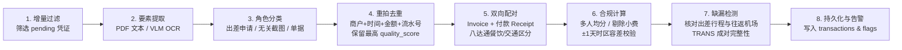

# 智能报销助手 — 详细设计文档（LLD）

## 1. 数据库 Schema 设计（PostgreSQL / Supabase）

所有业务表均强制包含 `user_id UUID NOT NULL` 并启用 Row-Level Security（RLS），确保 V1 单用户与未来多租户平滑过渡。

### 1.1 核心表结构

```sql
-- 1. 用户扩展配置表（与 Supabase auth.users 1:1 关联）
CREATE TABLE public.user_profiles (
    user_id         UUID PRIMARY KEY REFERENCES auth.users(id) ON DELETE CASCADE,
    display_name    TEXT NOT NULL DEFAULT 'Default User',
    default_template_id UUID NULL,
    preferences     JSONB NOT NULL DEFAULT '{}'::jsonb,
    created_at      TIMESTAMPTZ NOT NULL DEFAULT now(),
    updated_at      TIMESTAMPTZ NOT NULL DEFAULT now()
);

-- 2. 报销规则模板表
CREATE TABLE public.rule_templates (
    id              UUID PRIMARY KEY DEFAULT gen_random_uuid(),
    user_id         UUID NULL REFERENCES auth.users(id) ON DELETE CASCADE, -- NULL 表示系统内置默认模板
    is_system_default BOOLEAN NOT NULL DEFAULT false,
    name            TEXT NOT NULL,
    description     TEXT NOT NULL DEFAULT '',
    schema_version  TEXT NOT NULL DEFAULT '1.0',
    rules_json      JSONB NOT NULL, -- 规则 DSL（见第 2 节）
    created_at      TIMESTAMPTZ NOT NULL DEFAULT now(),
    updated_at      TIMESTAMPTZ NOT NULL DEFAULT now()
);
CREATE INDEX idx_rule_templates_user ON public.rule_templates(user_id, is_system_default);

-- 3. 报销批次表（对应原 报销/出差/<YYYYMMDD> 或 餐费/<YYYYMMDD>）
CREATE TABLE public.reimbursement_batches (
    id              UUID PRIMARY KEY DEFAULT gen_random_uuid(),
    user_id         UUID NOT NULL REFERENCES auth.users(id) ON DELETE CASCADE,
    template_id     UUID NOT NULL REFERENCES public.rule_templates(id),
    expense_type    TEXT NOT NULL, -- 如 'business_trip' | 'meal'
    title           TEXT NOT NULL,
    batch_date      DATE NOT NULL, -- 批次起始日期 YYYY-MM-DD
    trip_start_date DATE NULL,     -- 从出差申请提取的开始日期
    trip_end_date   DATE NULL,     -- 从出差申请提取的结束日期
    destinations    JSONB NOT NULL DEFAULT '[]'::jsonb, -- 出差目的地城市/机场列表
    status          TEXT NOT NULL DEFAULT 'draft', -- draft | processing | review_required | ready | exported
    missing_alerts  JSONB NOT NULL DEFAULT '[]'::jsonb, -- 疑似漏交发票清单（如往返机场 TRANS）
    created_at      TIMESTAMPTZ NOT NULL DEFAULT now(),
    updated_at      TIMESTAMPTZ NOT NULL DEFAULT now()
);
CREATE INDEX idx_batches_user_date ON public.reimbursement_batches(user_id, batch_date DESC);

-- 4. 原始凭证文件表（对应 raw/，不可变）
CREATE TABLE public.raw_documents (
    id              UUID PRIMARY KEY DEFAULT gen_random_uuid(),
    user_id         UUID NOT NULL REFERENCES auth.users(id) ON DELETE CASCADE,
    batch_id        UUID NOT NULL REFERENCES public.reimbursement_batches(id) ON DELETE CASCADE,
    original_filename TEXT NOT NULL,
    mime_type       TEXT NOT NULL,
    file_size_bytes BIGINT NOT NULL,
    sha256_hash     TEXT NOT NULL,
    storage_key     TEXT NOT NULL, -- {user_id}/{batch_id}/raw/{id}.{ext}
    doc_role        TEXT NOT NULL DEFAULT 'unknown', -- invoice | payment_receipt | trip_application | irrelevant | unknown
    ocr_status      TEXT NOT NULL DEFAULT 'pending', -- pending | processing | completed | failed
    extracted_json  JSONB NULL, -- VLM/OCR 提取的客观结构化字段
    quality_score   REAL NULL,  -- 清晰度/完整度评分，用于同凭证重拍择优
    duplicate_of_id UUID NULL REFERENCES public.raw_documents(id) ON DELETE SET NULL,
    exif_taken_at   TIMESTAMPTZ NULL,
    client_ocr_json JSONB NULL, -- iPhone 端侧 Vision 框架提取的原始文本行与坐标框（免费离线优先）
    created_at      TIMESTAMPTZ NOT NULL DEFAULT now()
);
CREATE UNIQUE INDEX idx_raw_docs_batch_hash ON public.raw_documents(batch_id, sha256_hash);
CREATE INDEX idx_raw_docs_user_batch ON public.raw_documents(user_id, batch_id);

-- 5. 交易明细表（去重与配对后的逻辑报销单元）
CREATE TABLE public.transactions (
    id              UUID PRIMARY KEY DEFAULT gen_random_uuid(),
    user_id         UUID NOT NULL REFERENCES auth.users(id) ON DELETE CASCADE,
    batch_id        UUID NOT NULL REFERENCES public.reimbursement_batches(id) ON DELETE CASCADE,
    category        TEXT NOT NULL, -- EAT | DRINK | TRANS | Others | UNKNOWN
    region_scope    TEXT NOT NULL, -- in_scope(范围内) | out_of_scope(范围外)
    region_detail   TEXT NOT NULL, -- 美洲 | 大陆 | HK | 新加坡 | 其他
    tx_date         DATE NOT NULL,
    merchant        TEXT NOT NULL,
    currency        TEXT NOT NULL, -- ISO 4217: USD | CNY | HKD | SGD ...
    original_amount NUMERIC(12, 2) NOT NULL,
    tip_amount      NUMERIC(12, 2) NOT NULL DEFAULT 0.00,
    split_count     INT NOT NULL DEFAULT 1, -- 多人均分份数
    claim_amount    NUMERIC(12, 2) NOT NULL, -- 实际报销金额
    airport_direction TEXT NULL, -- To | From（仅 TRANS）
    airport_iata    TEXT NULL,   -- 如 LAX, HKG, SJC, SIN
    payment_status  TEXT NOT NULL, -- paired | missing_payment | missing_invoice | exempted_transit
    flags           JSONB NOT NULL DEFAULT '[]'::jsonb, -- 高亮告警标签数组
    notes           TEXT NOT NULL DEFAULT '',
    is_user_verified BOOLEAN NOT NULL DEFAULT false,
    created_at      TIMESTAMPTZ NOT NULL DEFAULT now(),
    updated_at      TIMESTAMPTZ NOT NULL DEFAULT now()
);
CREATE INDEX idx_transactions_user_batch ON public.transactions(user_id, batch_id);

-- 6. 交易与原始凭证多对多关联表（支持 1 笔交易关联 1~2 张主凭证：invoice + receipt）
CREATE TABLE public.transaction_documents (
    transaction_id  UUID NOT NULL REFERENCES public.transactions(id) ON DELETE CASCADE,
    raw_document_id UUID NOT NULL REFERENCES public.raw_documents(id) ON DELETE CASCADE,
    user_id         UUID NOT NULL REFERENCES auth.users(id) ON DELETE CASCADE,
    link_role       TEXT NOT NULL, -- primary | invoice | receipt
    export_filename TEXT NULL,     -- 如 EAT_20261009_SGD_21-23_invoice.jpg
    PRIMARY KEY (transaction_id, raw_document_id)
);

-- 7. 异步处理与导出任务表
CREATE TABLE public.jobs (
    id              UUID PRIMARY KEY DEFAULT gen_random_uuid(),
    user_id         UUID NOT NULL REFERENCES auth.users(id) ON DELETE CASCADE,
    batch_id        UUID NOT NULL REFERENCES public.reimbursement_batches(id) ON DELETE CASCADE,
    job_type        TEXT NOT NULL, -- process_batch | export_bundle
    status          TEXT NOT NULL DEFAULT 'queued', -- queued | running | succeeded | failed
    progress        INT NOT NULL DEFAULT 0,
    result_storage_key TEXT NULL, -- 导出 ZIP 包路径
    error_message   TEXT NULL,
    created_at      TIMESTAMPTZ NOT NULL DEFAULT now(),
    updated_at      TIMESTAMPTZ NOT NULL DEFAULT now()
);
CREATE INDEX idx_jobs_user_batch ON public.jobs(user_id, batch_id, created_at DESC);
```

### 1.2 RLS 隔离策略示例

```sql
ALTER TABLE public.reimbursement_batches ENABLE ROW LEVEL SECURITY;
CREATE POLICY "batches_owner_only" ON public.reimbursement_batches
    USING (auth.uid() = user_id)
    WITH CHECK (auth.uid() = user_id);

-- rule_templates 允许读取系统默认模板 (user_id IS NULL) 或本人模板
ALTER TABLE public.rule_templates ENABLE ROW LEVEL SECURITY;
CREATE POLICY "templates_read" ON public.rule_templates
    FOR SELECT USING (user_id IS NULL OR auth.uid() = user_id);
CREATE POLICY "templates_write" ON public.rule_templates
    FOR ALL USING (auth.uid() = user_id) WITH CHECK (auth.uid() = user_id);
```

---

## 2. 规则模板 DSL（CMI 默认模板设计）

规则模板以 JSON Schema 校验，完整覆盖 `报销/AGENTS.md` 中的所有 CMI 合规规则，并支持用户复制修改：

```json
{
  "schema_version": "1.0",
  "template_code": "cmi_default_v1",
  "expense_types": [
    { "code": "business_trip", "label": "出差报销", "require_trip_reference": true },
    { "code": "meal", "label": "日常餐费", "require_trip_reference": false }
  ],
  "categories": [
    { "code": "EAT", "label": "餐费-正餐", "group": "餐费" },
    { "code": "DRINK", "label": "餐费-饮品", "group": "餐费" },
    { "code": "TRANS", "label": "交通费（仅限往返机场）", "group": "交通费" },
    { "code": "Others", "label": "其他（含市内交通）", "group": "其他" },
    { "code": "UNKNOWN", "label": "待分类", "group": "待分类" }
  ],
  "region_hierarchy": {
    "in_scope": {
      "label": "范围内",
      "regions": [{ "code": "americas", "label": "美洲", "currencies": ["USD"] }]
    },
    "out_of_scope": {
      "label": "范围外",
      "regions": [
        { "code": "mainland_cn", "label": "大陆", "currencies": ["CNY"] },
        { "code": "hk", "label": "HK", "currencies": ["HKD"] },
        { "code": "sg", "label": "新加坡", "currencies": ["SGD"] },
        { "code": "other_overseas", "label": "其他", "currencies": ["*"] }
      ]
    },
    "preserve_original_currency": true
  },
  "compliance_rules": {
    "require_invoice_payment_closure": true,
    "transit_direct_pay_exemptions": ["octopus_mtr", "credit_card_public_transit"],
    "meal_split_for_multiple_diners": true,
    "exclude_ride_hailing_tips": {
      "enabled": true,
      "providers": ["Uber", "Grab", "Taxi", "Lyft", "DiDi"],
      "highlight_flag": "TIP_EXCLUDED"
    },
    "timezone_tolerance_days": 1,
    "check_missing_airport_transfers": true,
    "deduplicate_reshot_receipts": true,
    "filter_irrelevant_files": true
  },
  "naming_and_export": {
    "standard_pattern": "{category}_{date}_{currency}_{amount_hyphen}{role_suffix}.{ext}",
    "airport_transfer_pattern": "TRANS_{direction}{iata}_{date}_{currency}_{amount_hyphen}{role_suffix}.{ext}",
    "excel_group_levels": ["category_group", "region_scope", "region_detail_and_currency"],
    "excel_filename_pattern": "{expense_type_label}汇总_{batch_date}.xlsx"
  }
}
```

---

## 3. 核心 API 契约（OpenAPI 3.1，iOS 与未来 Web 共用）

所有接口均挂载于 `/api/v1`，请求头必须携带 `Authorization: Bearer <Supabase_JWT>`。

| 模块 | Method & Path | 说明 |
| :--- | :--- | :--- |
| **模板管理** | `GET /templates` | 获取可用规则模板（含系统默认 CMI 模板与用户自定义模板） |
| | `POST /templates` | 新建自定义规则模板（校验 DSL Schema） |
| | `POST /templates/{id}/clone` | 基于已有模板（如 CMI 默认模板）派生新模板 |
| | `PATCH /templates/{id}` | 更新用户自定义模板（禁止修改 `is_system_default=true` 记录） |
| **批次管理** | `GET /batches` | 分页查询报销批次列表 |
| | `POST /batches` | 创建报销批次（指定 `template_id`、`expense_type`、`batch_date`） |
| | `GET /batches/{id}` | 获取批次详情、处理状态、缺漏告警（`missing_alerts`） |
| | `DELETE /batches/{id}` | 删除批次及关联凭证/导出文件 |
| **凭证上传** | `POST /batches/{id}/documents/presign` | 传入 `filename`, `mime_type`, `sha256_hash`；若同批次已存在相同哈希则返回 `already_exists=true` 实现幂等秒传，否则返回对象存储预签名上传 URL |
| | `POST /batches/{id}/documents/confirm` | 客户端直传完成后确认入库（可附带 iOS `Vision` 端侧提取的 `client_ocr_json` 与 EXIF 时间） |
| **处理与复核** | `POST /batches/{id}/process` | 触发增量处理任务（仅处理 `ocr_status=pending` 的新增凭证），返回 `job_id` |
| | `GET /batches/{id}/transactions` | 获取三级分组后的交易明细与异常高亮标记 |
| | `PATCH /transactions/{tx_id}` | 用户人工微调分类、均分人数、小费、配对关系或备注 |
| **导出与任务** | `POST /batches/{id}/export` | 触发导出任务（生成 Excel + 重命名凭证 + ZIP），返回 `job_id` |
| | `GET /jobs/{job_id}` | 查询异步任务进度与导出包预签名下载 URL |
| **账号合规** | `DELETE /account` | 注销并彻底删除当前用户全部数据与存储文件（App Store 审核必需） |

---

## 4. 服务端确定性处理管线（Processing Pipeline）



- **幂等与增量**：当用户向同一批次补充拍照后再次触发 `process`，管线仅对新上传凭证执行 OCR，随后与该批次已有交易做全局配对、去重与缺漏重算，**已由用户人工确认（`is_user_verified = true`）的字段不被覆盖**。
- **金额精度**：全链路金额使用 `Decimal` / PostgreSQL `NUMERIC(12, 2)`，禁止浮点数运算；命名时使用 `<元>-<分>`（如 `21-23`）。

---

## 5. 导出包规范（Export Bundle）

导出服务生成 `export_{batch_date}_{short_id}.zip`，内部结构与原电脑端 `output/` 完全一致并升级：
1. **`{expense_type_label}汇总_{batch_date}.xlsx`**（`openpyxl` 生成）：
   - **明细表**：按 `报销分类 → 范围内/范围外 → 地域（按币种）` 三级分组，含 `SUM` 小计/合计公式。
   - **必填列**：报销分类、区域范围、地域、原始文件名、重命名后文件名（含超链接指向同目录文件）、交易日期、商户/事由、币种、原单金额、报销金额、付款凭证状态、备注。
   - **异常高亮**：缺付款凭证（`[待确认-缺付款凭证]`）、缺 Invoice（`[待确认-缺Invoice]`）、含小费剔除、多人均分、`UNKNOWN` 行自动填充醒目底色并附批注。
   - **疑似漏交清单 Sheet / 区块**：单独列出缺失的往返机场 `TRANS` 凭证与日期断层。
2. **标准化凭证文件**：位于 ZIP 根目录或 `vouchers/` 子目录，按规则模板命名（如 `EAT_20261009_SGD_21-23_invoice.jpg`、`TRANS_ToLAX_20261009_USD_100-94.pdf`）。
3. **`.processed_manifest.json`**：记录原始文件哈希、交易指纹与导出文件名映射，便于审计追溯。

---

## 6. iOS 客户端模块设计（Swift / SwiftUI）

1. **核心模块划分**：
   - `CoreNetwork`：基于 OpenAPI 契约生成的强类型 API Client、JWT 自动刷新拦截器、`URLSession` 后台上传管理器。
   - `LocalStore`：基于 `SwiftData` 的离线存储（`LocalBatch`、`LocalDocument`），原图存放在 App `Documents/RawVault/{batchId}/`（只读保护，设置 `NSURLIsExcludedFromBackupKey` 避免占用 iCloud 备份配额或按用户开关控制）。
   - `CaptureModule`：集成 `VNDocumentCameraViewController`（多页连拍、自动切边增强）、`PhotosPicker` 多选导入、`UIDocumentPickerViewController` PDF 导入，以及 iOS **Share Extension**（支持从微信/邮件/Uber/Grab 直接“分享到报销助手”）。
   - `ReviewModule`：按三级分组展示交易列表，顶部聚合异常提示卡片（缺凭证/小费/均分/缺机场），支持左滑/点选快速修正分类与人数、左右对比查看关联的 Invoice 与 Receipt 原图。
   - `TemplateModule`：查看 CMI 默认模板规则详情、一键复制为自定义模板并可视化编辑开关/地域/命名规则。
   - `ExportModule`：触发云端打包、展示进度、下载 ZIP 后调用 `UIActivityViewController`（Share Sheet）导出。
